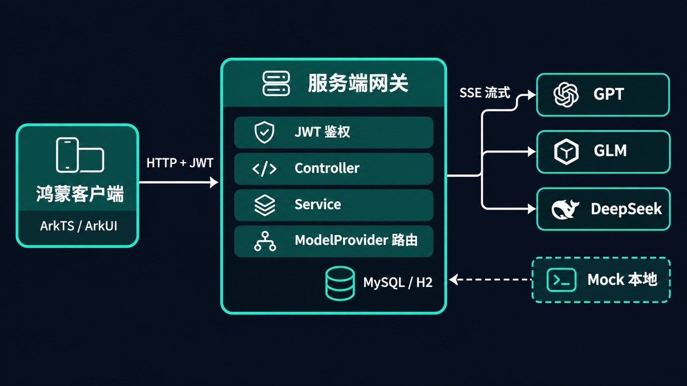

# Harmony AI Assistant

一个跑在鸿蒙上的多模型 AI 对话助手，包含**鸿蒙客户端**与**服务端网关**两部分。

## 为什么做这个

主流大模型客户端在鸿蒙端接入不便，各家应用分散、会话记录互不打通；客户端直连厂商接口还要面对三件事：**鉴权方式各不相同、请求体与流式事件格式各不相同、密钥必须下发到端侧**。

所以这个项目拆成两块：客户端只对接一套统一协议，服务端统一接入多家模型并托管密钥。新增模型只改服务端，客户端无需重新发版。

## 功能特性

**客户端**
- ArkTS / ArkUI 声明式开发，Stage 模型，适配手机与平板
- 首页信息流、对话页、多模型入口，深色主题
- 统一网络层封装与登录态管理，鉴权失效自动回到登录

**服务端**
- 一套 `Result` 响应体 + 一套 SSE 流式事件，客户端只需解析一次
- 策略模式适配多模型，按 `modelCode` 路由，新增模型只需一个实现类 + 一行配置
- JWT 鉴权 + 会话归属校验，会话与历史消息按用户隔离
- 多轮上下文按轮数与字符预算截断，控制单次请求规模
- 默认 H2 内存库与本地 mock 模型，**不需要 MySQL、不需要任何 API Key 即可完整演示**

## 系统架构



一次对话的链路：客户端带 JWT 发起请求 → 拦截器校验身份 → 校验会话归属 → 取历史上下文并截断 → 落库用户消息 → 按 `modelCode` 路由到对应模型适配器 → 消费上游流式响应并转换成统一事件推给客户端 → 事务内落库回答并更新会话时间。

## 技术栈

| 部分 | 选型 |
|---|---|
| 客户端 | ArkTS、ArkUI、Stage 模型、DevEco Studio（HarmonyOS SDK API 11 及以上） |
| 服务端 | Java 17、Spring Boot 3.5、Spring MVC、MyBatis |
| 存储 | H2（默认，内存）/ MySQL 8 |
| 鉴权 | JJWT 0.12（HS256）、BCrypt |
| 流式 | SseEmitter + JDK HttpClient |
| 构建 | Maven（含 Wrapper）/ Hvigor |

## 目录结构

```
harmony-ai-assistant/
├── client/                  鸿蒙客户端（ArkTS）
│   ├── entry/src/main/ets/  页面、网络层、状态管理
│   └── AppScope/            应用级配置
├── server/                  服务端网关（Java）
│   ├── src/main/java/com/yunmo/gateway/
│   │   ├── auth/            JWT 与请求级用户上下文
│   │   ├── controller/      登录、会话、对话接口
│   │   ├── service/         认证、会话管理、对话编排
│   │   ├── provider/        模型策略接口、注册表与四种适配器
│   │   ├── mapper/          MyBatis 注解 SQL
│   │   └── model/           entity / dto / vo
│   └── src/main/resources/  H2 与 MySQL 配置、建表脚本
└── docs/                    接口明细、客户端对接说明
```

## 快速开始

### 1. 启动服务端

环境要求：JDK 17，可访问 Maven Central（首次构建会下载依赖）。

```bash
cd server

# Windows
mvnw.cmd spring-boot:run

# macOS / Linux
./mvnw spring-boot:run
```

服务监听 `http://localhost:8080`。默认使用 H2 内存库，启动时自动建表并写入演示账号 **demo / demo123**，进程退出后数据清空。

### 2. 运行客户端

1. 用 DevEco Studio 打开 `client/` 目录
2. 修改 `client/entry/src/main/ets/common/net/RequestUtils.ets` 中的 `BASE_URL`，指向运行服务端那台电脑的**局域网 IP**（手机与电脑需在同一网络）：
   ```ts
   export const BASE_URL: string = 'http://192.168.x.x:8080'
   ```
3. 连接鸿蒙设备或模拟器运行

### 3. 跑一次对话

```bash
# 登录拿 token
TOKEN=$(curl -sS http://localhost:8080/auth/login \
  -H 'Content-Type: application/json' \
  -d '{"username":"demo","password":"demo123"}' | sed -n 's/.*"token":"\([^"]*\)".*/\1/p')

# 新建会话
curl -sS http://localhost:8080/conversation \
  -H "Authorization: Bearer $TOKEN" -H 'Content-Type: application/json' \
  -d '{"title":"演示会话","modelCode":"mock"}'

# 流式对话（mock 模型每 500ms 返回一片，共 20 片）
curl -N http://localhost:8080/chat/completions \
  -H "Authorization: Bearer $TOKEN" -H 'Content-Type: application/json' \
  -d '{"conversationId":1,"modelCode":"mock","content":"你好"}'
```

输出形如：

```text
data:{"type":"delta","content":"你好，"}
data:{"type":"delta","content":"我是"}
...
data:{"type":"done"}
```

也可直接运行 `server/scripts/demo.sh`，或用支持 HTTP Client 的 IDE 打开 `server/scripts/demo.http`。

## 接口

| 方法 | 路径 | 说明 |
|---|---|---|
| POST | `/auth/login` | 登录，返回 JWT |
| GET | `/conversation/list` | 当前用户的会话列表 |
| POST | `/conversation` | 新建会话 |
| GET | `/conversation/{id}/messages?page=1&size=20` | 历史消息分页 |
| DELETE | `/conversation/{id}` | 删除会话 |
| POST | `/chat/completions` | 流式对话（SSE） |

完整请求与响应示例见 [docs/api.md](docs/api.md)，客户端接入要点见 [docs/端侧对接说明.md](docs/端侧对接说明.md)。

## 协议约定

**普通响应**统一为 HTTP 200 + 三段式结构，业务状态放在 `status` 字段：

```json
{ "status": 200, "message": "success", "data": {} }
```

| status | 含义 |
|---|---|
| 200 | 成功 |
| 400 | 参数错误（含错误密码、未知或未启用的模型） |
| 401 | 未登录或 JWT 失效 |
| 404 | 资源不存在或越权 |
| 500 | 服务端异常 |

除 `POST /auth/login` 外，所有接口都需要 `Authorization: Bearer <token>`。签名密钥通过 `JWT_SECRET` 环境变量注入，仓库内的默认值仅供本地演示。

**流式响应**为 `text/event-stream`，每个事件的 data 是统一事件对象，不套 `Result`：

```json
{ "type": "delta", "content": "增量文本" }
{ "type": "done" }
{ "type": "error", "content": "错误说明" }
```

客户端依次追加 `delta`，收到 `done` 结束，收到 `error` 判定失败。

## 接入真实模型

`server/src/main/resources/application.yml` 的 `ai.models` 把 `modelCode` 映射到具体适配器：

```yaml
ai:
  models:
    - code: gpt
      provider: openai
      base-url: https://api.openai.com
      api-key: ${OPENAI_API_KEY:}
      model-name: gpt-4o-mini
      enabled: true
```

密钥通过环境变量注入，不写入代码库。`mock` 默认启用；真实模型默认关闭，调用未启用的模型返回 `400 模型未启用`。

## 切换到 MySQL

1. 准备可访问的 MySQL 8 并建库：`CREATE DATABASE harmony_ai_gateway CHARACTER SET utf8mb4;`
2. 设置 `MYSQL_URL`、`MYSQL_USER`、`MYSQL_PASSWORD`
3. 以 mysql profile 启动：`java -jar target/harmony-ai-gateway-1.0.0.jar --spring.profiles.active=mysql`

mysql profile 会改用 `schema-mysql.sql` 建表。MySQL 不支持 `CREATE INDEX IF NOT EXISTS`，因此该脚本把索引内联在 `CREATE TABLE IF NOT EXISTS` 中，适用于全新库。

## 开发与测试

```bash
cd server
./mvnw test        # 单元与集成测试
./mvnw clean package
```

测试覆盖 JWT 签发与过期、登录与鉴权链路、模型注册表路由、上游流式解析、上下文截断边界。

## Roadmap

- 会话级并发控制，避免同一会话的请求交错
- 有界任务队列与容量预约，替代当前的固定线程池
- 上游分片空闲超时与心跳
- 接入更多模型与统一的事件扩展字段
- 客户端补充对话流式渲染与消息历史

## 致谢

- 客户端在开源鸿蒙 AI 客户端的基础上二次开发，完成了与服务端的接口对接、响应结构与鉴权处理对齐，以及主题、文案与页面配置的定制
- 流式协议与请求体格式对齐 OpenAI Chat Completions 规范，便于复用生态中的工具与文档

## License

[MIT](LICENSE)
