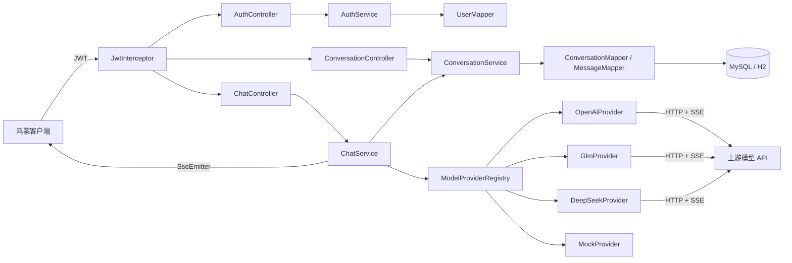

# Harmony AI Gateway

面向鸿蒙客户端的**多模型聚合网关**。把 OpenAI、智谱 GLM、DeepSeek 等模型的鉴权方式、请求体结构与流式事件格式收敛成同一套接口，客户端只需对接一种协议，新增模型无需发版。

## 为什么需要它

客户端直连各家模型会碰到三个问题：每家鉴权方式不同、请求体与流式事件格式不同、密钥必须下发到端侧。一个聚合层可以解决：端侧只认一套协议，模型与密钥集中在服务端管理，扩展模型时不影响已发布的客户端。

## 功能特性

- **统一协议**：一套 `Result` 响应体 + 一套 SSE 流式事件，端侧只解析一次
- **策略路由**：按 `modelCode` 选择模型适配器，新增模型只需一个 `ModelProvider` 实现类与一行配置
- **流式透传**：`SseEmitter` 把上游分片原样推给端侧，支持客户端断连时中断上游请求
- **多账号隔离**：JWT 无状态鉴权 + 会话归属校验，会话与历史消息按用户隔离
- **上下文管理**：取最近若干轮历史并在字符预算内截断，控制单次请求规模
- **开箱可跑**：默认 H2 内存库与本地 mock 模型，不需要 MySQL、不需要任何 API Key

## 技术栈

| 分类 | 选型 |
|---|---|
| 语言与运行时 | Java 17 |
| 框架 | Spring Boot 3.5、Spring MVC |
| 持久层 | MyBatis（注解 SQL）、MySQL 8 / H2 |
| 鉴权 | JJWT 0.12（HS256）、BCrypt |
| 流式 | SseEmitter + JDK HttpClient |
| 构建 | Maven（含 Maven Wrapper） |

## 架构



一次对话的完整链路：鉴权拦截 → 校验会话归属 → 取历史上下文并截断 → 落库用户消息 → 按 `modelCode` 路由到 Provider → 消费上游流式响应并转成统一事件推送给客户端 → 事务内落库回答并更新会话时间。

## 快速开始

**环境要求**：JDK 17、可访问 Maven Central（首次构建会下载依赖）

```bash
git clone <your-repo-url> && cd harmony-ai-gateway

# Windows
mvnw.cmd clean package
mvnw.cmd spring-boot:run

# macOS / Linux
./mvnw clean package
./mvnw spring-boot:run
```

服务监听 `http://localhost:8080`。默认使用 H2 内存库，启动时自动建表并写入演示账号 **demo / demo123**，数据在进程退出后清空。

### 跑一次对话

```bash
# 登录拿 token
TOKEN=$(curl -sS http://localhost:8080/auth/login \
  -H 'Content-Type: application/json' \
  -d '{"username":"demo","password":"demo123"}' | sed -n 's/.*"token":"\([^"]*\)".*/\1/p')

# 新建会话
curl -sS http://localhost:8080/conversation \
  -H "Authorization: Bearer $TOKEN" -H 'Content-Type: application/json' \
  -d '{"title":"演示会话","modelCode":"mock"}'

# 流式对话（mock 模型每 500ms 返回一片，共 20 片）
curl -N http://localhost:8080/chat/completions \
  -H "Authorization: Bearer $TOKEN" -H 'Content-Type: application/json' \
  -d '{"conversationId":1,"modelCode":"mock","content":"你好"}'
```

也可以直接运行 `bash scripts/demo.sh`，或用支持 HTTP Client 的 IDE 打开 `scripts/demo.http`。

输出形如：

```text
data:{"type":"delta","content":"你好，"}
data:{"type":"delta","content":"我是"}
...
data:{"type":"done"}
```

## 接口

| 方法 | 路径 | 说明 |
|---|---|---|
| POST | `/auth/login` | 登录，返回 JWT |
| GET | `/conversation/list` | 当前用户的会话列表 |
| POST | `/conversation` | 新建会话 |
| GET | `/conversation/{id}/messages?page=1&size=20` | 历史消息分页 |
| DELETE | `/conversation/{id}` | 删除会话 |
| POST | `/chat/completions` | 流式对话（SSE） |

完整请求与响应示例见 [docs/api.md](docs/api.md)。

## 协议约定

**普通响应**统一为 HTTP 200 + 三段式结构，业务状态放在 `status` 字段：

```json
{ "status": 200, "message": "success", "data": {} }
```

| status | 含义 |
|---|---|
| 200 | 成功 |
| 400 | 参数错误（含错误密码、未知或未启用的模型） |
| 401 | 未登录或 JWT 失效 |
| 404 | 资源不存在或越权 |
| 500 | 服务端异常 |

除 `POST /auth/login` 外，所有接口都需要 `Authorization: Bearer <token>`。签名密钥通过 `JWT_SECRET` 环境变量注入，仓库内的默认值仅供本地演示使用。

**流式响应**为 `text/event-stream`，每个事件的 data 是一个统一事件对象，不套 `Result`：

```json
{ "type": "delta", "content": "增量文本" }
{ "type": "done" }
{ "type": "error", "content": "错误说明" }
```

客户端把 `delta` 依次追加，收到 `done` 结束，收到 `error` 判定失败。

## 接入真实模型

`application.yml` 的 `ai.models` 把客户端的 `modelCode` 映射到具体 Provider：

```yaml
ai:
  models:
    - code: gpt
      provider: openai
      base-url: https://api.openai.com
      api-key: ${OPENAI_API_KEY:}
      model-name: gpt-4o-mini
      enabled: true
```

密钥通过环境变量注入，不写入代码库。`mock` 默认启用；真实模型默认关闭，调用未启用的模型会返回 `400 模型未启用`。

新增模型时实现一个 `ModelProvider`（提供 URL、请求头、请求体、流解析），在 Registry 中按 code 注册，再补一段配置即可。

## 切换到 MySQL

1. 准备可访问的 MySQL 8 并建库：`CREATE DATABASE harmony_ai_gateway CHARACTER SET utf8mb4;`
2. 设置 `MYSQL_URL`、`MYSQL_USER`、`MYSQL_PASSWORD`
3. 以 mysql profile 启动：`java -jar target/harmony-ai-gateway-1.0.0.jar --spring.profiles.active=mysql`

mysql profile 会改用 `schema-mysql.sql` 建表。注意 MySQL 不支持 `CREATE INDEX IF NOT EXISTS`，因此该脚本把索引内联在 `CREATE TABLE IF NOT EXISTS` 中，适用于全新库；已有表的结构变更需自行迁移。

## 项目结构

```
src/main/java/com/yunmo/gateway
├── common/      统一响应、状态码、业务异常、全局异常处理
├── config/      拦截器注册、模型配置绑定、线程池
├── auth/        JWT 工具、鉴权拦截器、请求级用户上下文
├── controller/  登录、会话、对话三个入口
├── service/     认证、会话管理、对话编排
├── provider/    模型策略接口、注册表、四种适配器、统一事件
├── mapper/      MyBatis 注解 SQL
└── model/       entity / dto / vo
src/main/resources  H2 与 MySQL 配置、建表脚本、演示账号
src/test/java       单元与集成测试
docs/               接口明细、客户端对接说明
scripts/            请求演示脚本
```

## 开发

```bash
./mvnw test        # 运行全部测试
./mvnw clean package
```

测试覆盖 JWT 签发与过期、登录与鉴权链路、模型注册表路由、上游流式解析、上下文截断边界。

## Roadmap

- 会话级并发控制，避免同一会话的请求交错
- 有界任务队列与容量预约，替代当前的固定线程池
- 上游分片空闲超时与心跳
- 更多模型适配与统一的事件扩展字段

## 相关项目与致谢

- 流式协议与请求体格式对齐 OpenAI Chat Completions 规范，便于复用生态中的工具与文档
- 客户端侧为鸿蒙应用（ArkTS / ArkUI），本仓库只包含服务端

## License

[MIT](LICENSE)
